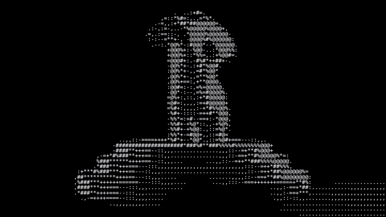
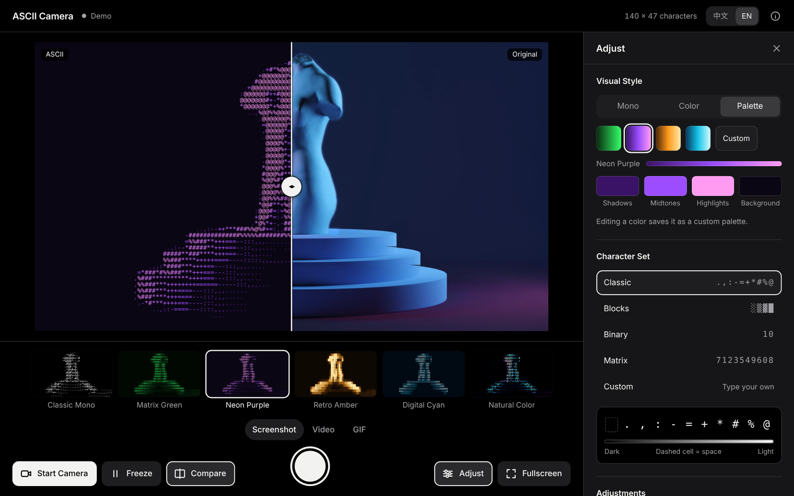

# ASCII Camera

**English** · [简体中文](README.zh-CN.md)

**[Try ASCII Camera](https://ascii.nine19een.com/)**

Turn your camera into real-time ASCII art, right in your browser. Choose a look, compare it with the original, and save a screenshot, video or GIF. All processing stays on your device.


A looping sculpture demo lets you try the app before granting camera access. Start the camera to apply the same effects to your own image.



## Features

- **Choose a look.** Six presets with live previews, three visual modes (Mono, Color and Palette), four built-in palettes and a custom palette.
- **Make it yours.** Classic, Blocks, Binary and Matrix character sets, plus your own characters. Adjust density, brightness and contrast.
- **Explore the image.** Compare with the original, freeze a frame, mirror the view or go fullscreen. On devices without element fullscreen, use an immersive in-page view.
- **Save your work.** PNG screenshots, MP4 / H.264 or WebM video, and GIFs up to 10 seconds. Exports contain the image you see, without audio.
- **Use it across screens.** Desktop and mobile layouts, with English and Simplified Chinese available without reloading.




## Using it

1. Open the app and try the demo with any preset.
2. Open **Adjust** to change the style, colors, characters and image settings.
3. Select **Start Camera** and allow access to use your camera. **Stop Camera** returns to the demo.
4. Choose **Screenshot**, **Video** or **GIF** above the shutter, then press it to capture. Choose MP4 or WebM under **Adjust → Export**.

With multiple cameras, select a device under **Adjust → Camera** while the camera is running. Device switching is disabled during recording.

## Run locally

Use Node.js 22.22.1 (see [.nvmrc](.nvmrc); minimum 22.12.0) and npm 10 or later.

```bash
npm ci
npm run dev
```

Open the local address printed by Vite, usually `http://localhost:5173`.

To build and preview the static site:

```bash
npm run build
npm run preview
```

The complete site is in `dist/`, including the required third-party source and license files. For camera access on a phone over your local network, see the [local HTTPS guide (Chinese)](docs/mobile-testing.zh-CN.md).

## How it works

Built with React, TypeScript, Vite and Canvas 2D.

- The camera and demo feed the same rendering pipeline. Character spacing follows measured glyph proportions, and palette gradients use OKLCH interpolation.
- The main view and six preset previews share one demo video decoder. React handles the interface; frame rendering runs outside React.
- Screenshots and recordings use the final visible canvas. Video containers are finalized locally for duration and seeking, without re-encoding; GIF encoding runs in a Web Worker.


See the [implementation notes](docs/implementation.md) for rendering, camera lifecycle, recording limits, source layout and development checks. [Demo video preparation (Chinese)](docs/demo-video.zh-CN.md) documents the bundled clip and its shared playback.

## Browser support

Camera access requires HTTPS or `localhost`. Recording formats depend on the browser's MediaRecorder and codec support; the app offers supported formats and falls back to WebM when MP4 recording is unavailable.

On iPhone Safari, some physical or combined camera entries may be unavailable; not every lens listed by the browser is supported. If a switch cannot be recovered, restart the camera. Android device compatibility has not been verified.

MP4 is the preferred format for phone albums and system players. WebM may not open in iPhone Photos or some players, and long WebM recordings require substantial memory. Keep the tab in the foreground while recording. GIFs are limited to 256 colors per frame.

## Privacy

Camera frames and exports are processed locally and are never uploaded. There is no backend, account, analytics or cloud storage. Camera access starts only when you select **Start Camera**; the microphone is never requested. The demo is bundled with the app, and local storage saves only interface preferences.

## License

ASCII Camera's own source code is released under the [MIT License](LICENSE).

The third-party demo video, poster and display assets containing that material are outside the project's MIT license. Their use is subject to the applicable permissions; see the [demo material license record (Chinese)](docs/licenses/demo-material.zh-CN.md).

See the [third-party copyright and license notices](public/third-party-licenses.txt) and [corresponding gifenc source and licenses](public/vendor/gifenc-1.0.3/NOTICE.txt), including the PNN-derived quantizer under MPL-2.0. The [gifenc license provenance record (Chinese)](docs/licenses/gifenc-1.0.3-provenance.zh-CN.md) provides the supporting history.

## Author

Made by **[nine19een](https://nine19een.com)**.
