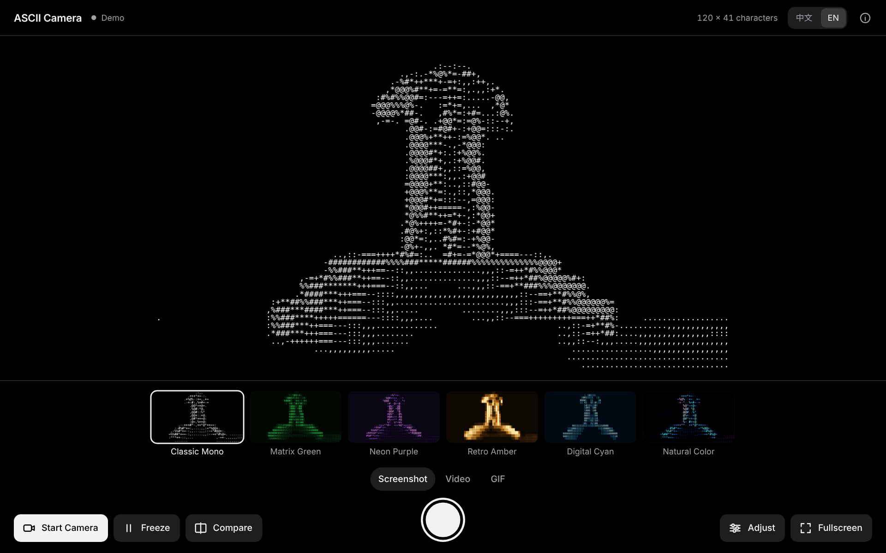
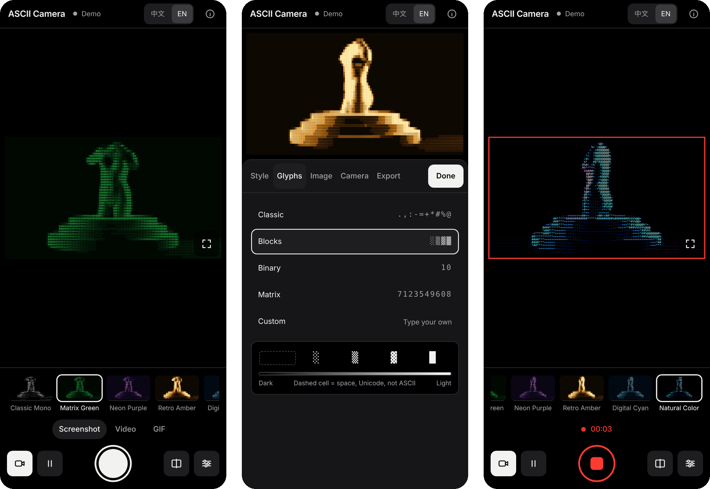
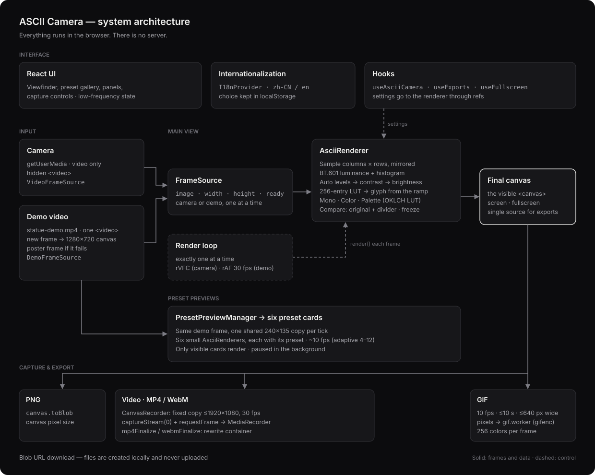
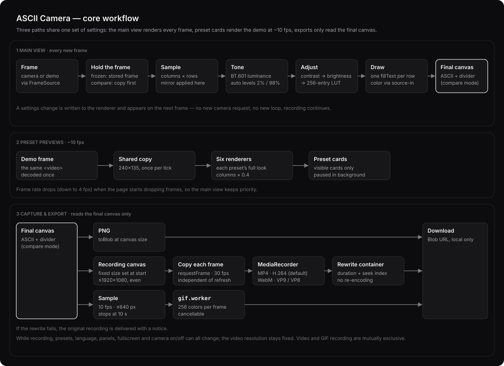

# ASCII Camera

**English** · [简体中文](README.zh-CN.md)

**v1.0.0 · formal Git freeze (Phase 06.3.2).** Features are frozen. The project owner has confirmed permission for the demo material’s use, public redistribution and related display. The Word/PDF introduction is synchronized at 1.0.0 (11-page PDF). There is no public deployment or formal release tag yet.

Real-time ASCII art from your camera, in the browser. Pick a look, compare it with the original, and save the result as PNG, MP4, WebM or GIF. Everything is processed locally; nothing is uploaded.



The page opens with a looping demo video, a rotating sculpture, so you can try every feature before allowing camera access. Start the camera and the same look applies to your own image.


<sub>Recorded with ASCII Camera's own MP4 export, then converted to GIF.</sub>

There is no public deployment yet. To try it, run it locally (see [Quick start](#quick-start)).

## Features

- **Live view.** Demo video or camera, the same pipeline for both. 60–180 columns, brightness −50 to +50, contrast 50–150 %, automatic levels, mirror (on by default).
- **Three visual styles.** Mono, Color (each character takes the color of its area) and Palette (a shadow → midtone → highlight gradient with its own background). Four built-in palettes, plus a custom palette that never overwrites the built-in ones.
- **Five character sets.** Classic ` .,:-=+*#%@`, Blocks ` ░▒▓█`, Binary, Matrix, and your own ramp, which is validated as you type.
- **Six presets with live previews.** Each card plays the demo in its own look. One click applies the whole look; every setting can still be adjusted afterwards.
- **Compare, freeze, fullscreen.** Drag a divider between the ASCII view and the original (mouse, touch or keyboard). Freeze keeps one frame and lets you keep adjusting it. On iPhone, fullscreen becomes an in-page immersive view.
- **Capture.**
  - PNG at the canvas's pixel size.
  - Video at 30 fps without audio, up to 1920 × 1080: MP4 / H.264 by default, WebM / VP9 as an option.
  - GIF at 10 fps, up to 10 s and 640 px wide.
- **Interface.** English and Simplified Chinese, switchable without reloading. Separate layouts for desktop, portrait phones and tablets, and landscape phones.




## Quick start

Requirements:

- Node.js 22.22.1 (see `.nvmrc`; `package.json` accepts `>=22.12.0`) and npm 10+.
- A recent desktop or mobile browser. The camera only works in a secure context (`http://localhost` or `https://`). The demo works anywhere.

```bash
npm install
npm run dev        # http://localhost:5173
```

| Command | What it does |
| --- | --- |
| `npm run dev` | Development server |
| `npm run dev:lan` | Development server on the local network (HTTP, so phones can't use the camera) |
| `npm run dev:https` | Local-network HTTPS for testing the camera on a phone; needs a local certificate (see below) |
| `npm run typecheck` | TypeScript type check |
| `npm run lint` | Oxlint |
| `npm test` | Unit tests (Vitest) |
| `npm run build` | Type check and production build into `dist/` |
| `npm run preview` | Serve the production build locally |

The build is a static site: `dist/` can be served by any static host.

## Using it

1. Open the page. The demo starts playing as ASCII art.
2. Pick a preset card. Open **Adjust** to change the visual style, palette, character set, density, brightness and contrast. When the settings no longer match a preset, the gallery shows "Custom settings".
3. Choose **Start Camera** and allow access. The view switches to your camera with the same look. **Stop Camera** returns to the demo.
4. Above the shutter, choose **Screenshot**, **Video** or **GIF**, then press the shutter. Video format (MP4 or WebM) is under **Adjust → Export**.
5. With several cameras, pick one under **Adjust → Camera** while the camera is running. Switching is locked during a recording.

### Presets

| Preset | Style | Palette | Characters | Columns | Brightness | Contrast |
| --- | --- | --- | --- | --- | --- | --- |
| Classic Mono (default) | Mono | — | Classic | 120 | 0 | 110 % |
| Matrix Green | Palette | Matrix Green | Matrix | 140 | +5 | 120 % |
| Neon Purple | Palette | Neon Purple | Classic | 140 | 0 | 115 % |
| Retro Amber | Palette | Retro Amber | Blocks | 130 | +5 | 110 % |
| Digital Cyan | Palette | Digital Cyan | Binary | 150 | 0 | 120 % |
| Natural Color | Color | — | Classic | 120 | 0 | 100 % |

Presets don't change the camera device, mirror, compare, freeze, fullscreen or an ongoing recording.

### Character sets

All ramps run from dark to light: sparse glyphs for shadows, dense ones for highlights.

- **Binary and Matrix.** Digits are ordered by their measured ink coverage in the current font, with a space as the darkest step. For a screen full of `0` and `1`, type `01` as a custom ramp.
- **Custom ramps.**
  - Up to 64 characters, at least 2 valid ones.
  - Some characters are dropped with a note: control characters, whitespace other than the space, duplicates, combining marks and emoji, and glyphs that don't fit one monospace cell (for example CJK characters).
  - If the input is invalid, the last valid ramp stays in use.
- **Blocks** uses Unicode block elements, so it isn't strictly ASCII. How well they line up depends on the system's monospace font.

## How it works



Vite, React and TypeScript, drawing with the Canvas 2D API. Runtime dependencies are React and [gifenc](https://github.com/mattdesl/gifenc). There is no backend, account or analytics.

**One frame source, one render loop.**
- The camera (a hidden `<video>`) and the demo video both implement a small `FrameSource` interface: image, width, height, ready.
- The renderer only sees that interface, so compare, freeze, screenshots and recording work the same with both.
- Exactly one main render loop runs at a time. It uses `requestVideoFrameCallback` for the camera (falling back to `requestAnimationFrame`) and `requestAnimationFrame` capped at 30 fps for the demo.

**Camera lifecycle.**
- Every start, stop, failure, unmount or page exit increments a session number. Asynchronous steps check it after each `await`, so a permission prompt that resolves after the user pressed Stop releases its stream immediately.
- When switching devices, the new camera opens before the old one closes, so a failed switch leaves the original running. If the driver can't open two cameras at once, the app retries after releasing the first and falls back to restoring it.
- A track ending (unplugged or taken by another app) returns the view to the demo with a message.

**Rendering a frame.**
1. The frame is drawn onto a canvas of `columns × rows` pixels; the mirror is applied here, so glyphs themselves are never flipped.
2. Rows are derived from the measured glyph advance of the current font, so the image keeps its proportions.
3. Each cell gets a BT.601 luminance value, and the histogram sets automatic black and white points (2nd / 98th percentiles, smoothed between frames).
4. Contrast and brightness are applied after the levels, so automatic levels never undo a manual adjustment. The result is one 256-entry lookup table per frame for glyphs and tones.
5. **Mono:** one `fillText` call per row.
6. **Color and Palette:** a white text layer is tinted by a one-pixel-per-cell color image using `source-in`. Palette colors come from a 256-entry table interpolated in OKLCH, rebuilt only when the palette changes.

**Preset previews.**
- The six cards use the same demo `<video>`: one decode, one time base.
- Each tick copies the current frame once into a shared 240 × 135 canvas. Six small renderers draw it with their preset's settings (at 40 % of the preset's column count, so the glyphs stay readable at card size).
- Previews run at about 10 fps. They lower their rate (down to 4 fps) when the page starts dropping frames, skip cards that are scrolled out of view, and pause in background tabs.

**React.** React manages only the interface and low-frequency state. Settings are written straight into the renderer, so a change appears on the next frame without restarting the camera or the loop. Language is a context value; switching it re-renders text only and doesn't remount anything.

**Recording video.**
- When recording starts, the app creates a recording canvas of fixed size (even dimensions, at most 1920 × 1080). On a 30 fps timeline it copies the visible canvas into it and submits each copy with `captureStream(0)` and `requestFrame()`.
- Because the size is fixed, entering fullscreen, resizing the window or switching between camera and demo mid-recording doesn't change the video's resolution.
- `MediaRecorder` encodes MP4 / H.264 or WebM / VP9 (VP8 as a fallback). The bitrate is estimated from the resolution: 2.5–12 Mbps.

**Finishing the file.**
- Chrome's MediaRecorder writes live-style files:
  - **WebM:** segment and cluster sizes are unknown, and there is no duration or index.
  - **MP4:** the file is fragmented, with a duration of 0.
- The project rewrites the container without re-encoding:
  - **WebM** gets known-size clusters, a duration and cues.
  - **MP4** becomes `ftyp | moov | mdat` with complete sample tables and a sync-sample index.
- If the rewrite fails, the original recording is still delivered, with a note that some players may not show its duration or allow seeking.

**GIF.** Frames are sampled at 10 fps and scaled to at most 640 px wide. They are handed to a Web Worker as transferable buffers and encoded one by one (256 colors per frame), so the main thread never holds more than one uncompressed frame.



## Project structure

```
src/
  App.tsx                     page layout: viewfinder, preset gallery, capture controls, adjust panel
  main.tsx, index.css
  ascii/                      renderer, character sets, palettes, presets, glyph metrics, settings
  camera/                     getUserMedia, error mapping, render loop
  media/frameSource.ts        FrameSource for the camera and the demo
  demo/                       DemoSource, statue-demo.mp4, statue-poster.jpg
  presets/                    PresetPreviewManager (live preset cards)
  export/                     recorders, MP4 / WebM container rewrite, GIF worker, downloads
  hooks/                      useAsciiCamera, useExports, useFullscreen, useCameraDevices, useLayout
  components/                 interface components
  i18n/                       zh-CN.ts, en.ts and the language provider
tests/                        Vitest unit tests and recorded fixtures
tools/demo-video/             script that produced the demo video from the source clip
docs/                         project brief, demo-video notes, phone testing guide (Chinese), assets
```

## Browsers and devices

The app checks for each capability it needs and degrades instead of failing:

| Capability | Needed for | Without it |
| --- | --- | --- |
| `getUserMedia` in a secure context | Camera | The demo keeps playing and a message explains why |
| `requestVideoFrameCallback` | Camera frame timing | `requestAnimationFrame` |
| `MediaRecorder` + `canvas.captureStream` | Video | Video recording is disabled |
| MP4 recording support | MP4 | WebM is used instead (for example in Firefox) |
| Web Workers | GIF | GIF is disabled |
| Element fullscreen | Fullscreen | In-page immersive view (for example on iPhone) |
| `IntersectionObserver` | Pausing off-screen preset cards | All cards keep rendering |

**What has been tested:**
- Earlier browser checks used headless Chrome, the demo video and Chrome's fake camera. Unit tests run in Node.js with Vitest.
- Phase 06.3 independently passed the production-build smoke checks in headless Edge 158 on Windows, including real downloads, fake-camera cleanup and recording-time changes. Firefox and Safari remain unverified.
- Real phones (iPhone Safari, Android Chrome) still need a final manual pass.

### Testing on a phone

Phone browsers allow the camera only over HTTPS or on `localhost`. `npm run dev:https` serves the app over HTTPS on your local network, using a certificate you create with [mkcert](https://github.com/FiloSottile/mkcert) in `.cert/`. The `.cert/` folder is ignored by Git.

The step-by-step guide (in Chinese) is [docs/mobile-testing.zh-CN.md](docs/mobile-testing.zh-CN.md). It covers installing the local CA on iPhone and Android, plus a USB port-forwarding alternative for Android.

## Tests

```bash
npm test
```

**What the unit tests cover:** the MP4 and WebM container rewrite, using short recordings made with Chrome's MediaRecorder (`tests/fixtures/`). An independent parser in the tests checks that:
- the output structure is complete;
- sample and block bytes are unchanged;
- duration and seek indexes are correct;
- truncated or corrupted input falls back to the original file without throwing.

`npm run typecheck` and `npm run lint` cover the rest of the code base statically.

**Not in the repository:** browser regression and performance checks from earlier development phases.

## Privacy

- The demo video is bundled with the page; no remote media is loaded.
- Camera frames, screenshots, videos and GIFs are processed and created in your browser and are never uploaded. There is no backend, account, analytics or cloud storage.
- The camera is requested only after you press **Start Camera**, and only video is requested, never the microphone. Stopping, switching devices or leaving the page releases the camera immediately.
- Files are downloaded through local Blob URLs:
  - a screenshot URL is released a few seconds after the download starts;
  - a video or GIF link stays until the next export, until you dismiss it, or until you leave the page.
- Local storage keeps four interface preferences: language, panel state, capture format and video format.

## Known limitations

- **Resolution:** set when recording starts, at most 1920 × 1080. If the canvas changes size during a recording, the picture is scaled to fit, with black bars.
- **WebM memory:** the WebM rewrite reads the whole recording into memory (peak about 2–3× the file size), and video recordings have no time limit. A long WebM recording, especially on a phone, can run out of memory; the original file is then delivered. The MP4 rewrite reads in pieces and is not affected, so use MP4 for long recordings.
- **WebM playback:** iPhone Photos and some players can't open WebM.
- **GIF colors and size:** each frame is limited to 256 colors, so gradients show banding. Files are fairly large (a 10 s, 640 × 360 GIF is a few MB).
- **Background tabs:** browsers throttle background tabs. Recording stalls there, and the demo and preset previews pause. Record in the foreground.
- **Camera names:** browsers only reveal device names after camera permission is granted.

## Documentation

These documents are in Chinese:

- [Project introduction](docs/intro/ascii-camera-introduction.zh-CN.pdf) ([Word](docs/intro/ascii-camera-introduction.zh-CN.docx)): product, architecture, rendering, recording and the main engineering problems, with screenshots.
- [Project brief](docs/PROJECT-BRIEF.zh-CN.md): the requirement baseline used across development phases.
- [Demo video notes](docs/demo-video.zh-CN.md): how the demo clip was graded and encoded, and its license note.
- [Phone testing over local HTTPS](docs/mobile-testing.zh-CN.md).

## License

The code is released under the [MIT License](LICENSE).

The demo video and its poster frame (`src/demo/statue-demo.mp4`, `src/demo/statue-poster.jpg`) are third-party material and are **not** covered by the MIT License:
- **Recorded permission:** on 2026-11-24 the project owner confirmed permission for this project’s non-commercial use, public redistribution and related display, including exported works (see [docs/demo-video.zh-CN.md](docs/demo-video.zh-CN.md)). This records the owner’s confirmation; it does not reproduce the underlying license terms or grant a general license for other uses.
- **Documentation images:** the screenshots and GIF in `docs/assets/`, and the images in the Word/PDF introduction in `docs/intro/`, are included in that confirmation and remain outside the project’s MIT license.
- **Forks:** if you fork the project for other uses, replace the demo video.

| Dependency | License | Notes |
| --- | --- | --- |
| [React](https://react.dev) | MIT | Interface |
| [gifenc](https://github.com/mattdesl/gifenc) 1.0.3 | MIT; PNN-derived quantizer MPL-2.0 | GIF encoding; exact source and notices shipped alongside the Worker |
| Vite, TypeScript, Oxlint, Vitest | MIT / Apache-2.0 | Development and build only, not shipped |

Runtime notices are in [third-party-licenses.txt](public/third-party-licenses.txt), with [corresponding gifenc source and license texts](public/vendor/gifenc-1.0.3/NOTICE.txt). Historical PnnQuant.js source from before gifenc's import already carried MPL-2.0; see the [license investigation](docs/licenses/gifenc-1.0.3-provenance.zh-CN.md). ASCII Camera's own separate code remains MIT licensed.

## Author

Made by **[nine19een](https://nine19een.com)**.

Source code: [github.com/nine19een/ascii-camera](https://github.com/nine19een/ascii-camera)
