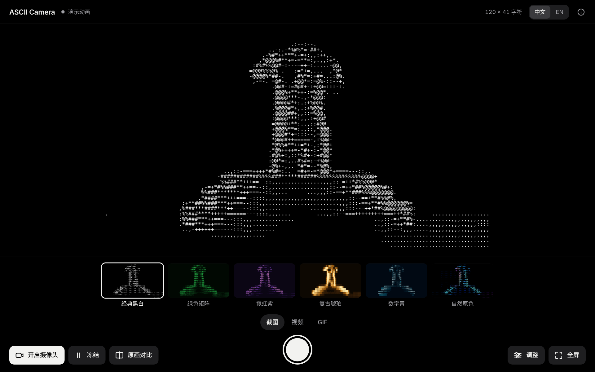
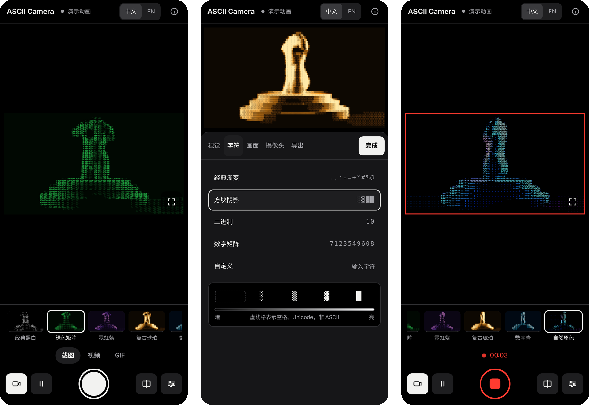
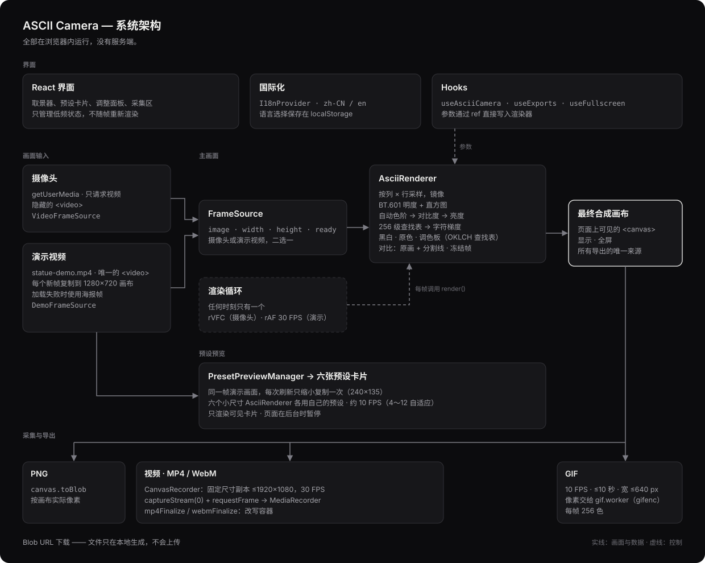
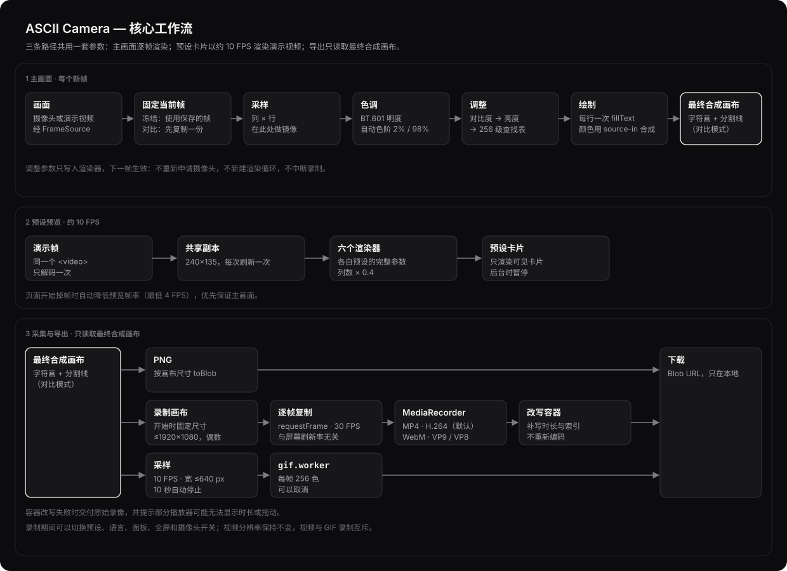

# ASCII Camera

[English](README.md) · **简体中文**

**[体验 ASCII Camera](https://ascii.nine19een.com/)**

在浏览器里，把摄像头画面实时转换成字符画。选择一种风格，与原画对比，再保存为截图、视频或 GIF。所有处理都在你的设备上完成。



无需开启摄像头，就能用循环播放的雕塑演示体验功能。开启摄像头后，同一套效果会作用于你自己的画面。


## 功能

- **选择风格。** 六种带动态预览的预设，黑白、原色、调色板三种视觉模式，四种内置调色板和自定义调色板。
- **自由调整。** 经典渐变、方块、二进制、矩阵字符集，也可以输入自己的字符。支持调整密度、亮度和对比度。
- **观察画面。** 与原画对比、冻结一帧、镜像或全屏。在不支持元素全屏的设备上，使用页面内沉浸式预览。
- **保存作品。** PNG 截图、MP4 / H.264 或 WebM 视频，以及最长 10 秒的 GIF。导出内容就是当前看到的画面，不含音频。
- **适应不同屏幕。** 提供桌面与移动布局，中英文切换无需刷新。




## 使用方法

1. 打开应用，用任意预设体验演示画面。
2. 打开「调整」，修改风格、颜色、字符和画面参数。
3. 点击「开启摄像头」并允许访问，使用自己的摄像头；「关闭摄像头」会回到演示画面。
4. 在快门上方选择「截图」「视频」或「GIF」，再按快门采集。MP4 / WebM 格式位于「调整 → 导出」。

连接多个摄像头时，可在摄像头运行期间通过「调整 → 摄像头」选择设备。录制中不能切换设备。

## 本地运行

使用 Node.js 22.22.1（见 [.nvmrc](.nvmrc)，最低 22.12.0）和 npm 10 或更新版本。

```bash
npm ci
npm run dev
```

打开 Vite 在终端显示的本地地址，通常是 `http://localhost:5173`。

构建并预览静态站点：

```bash
npm run build
npm run preview
```

完整站点位于 `dist/`，包含必要的第三方源码与许可文件。通过局域网在手机上使用摄像头，参见[本地 HTTPS 指南](docs/mobile-testing.zh-CN.md)。

## 实现方式

使用 React、TypeScript、Vite 和 Canvas 2D 构建。

- 摄像头与演示视频进入同一条渲染管线。字符布局按实测字形比例计算，调色板渐变使用 OKLCH 插值。
- 主画面和六张预设卡片共享一路演示视频解码。React 管理界面，逐帧渲染在 React 之外运行。
- 截图与录制都取自最终可见画布。视频在本地完成时长和定位索引的容器处理，不重新编码；GIF 由 Web Worker 编码。





[技术实现说明](docs/implementation.zh-CN.md)介绍渲染、摄像头生命周期、录制限制、源码结构和开发检查。[演示视频制作与接入](docs/demo-video.zh-CN.md)记录内置素材的处理方式和共享播放实现。

## 浏览器支持

摄像头需要 HTTPS 或 `localhost`。录制格式取决于浏览器的 MediaRecorder 和编码支持；应用会提供可用格式，不能录制 MP4 时回退到 WebM。

iPhone Safari 的部分物理或组合摄像头可能不可用，不保证支持浏览器列出的每一种镜头。切换无法恢复时，请重新开启摄像头。Android 实机兼容性尚未验证。

手机相册和系统播放器优先使用 MP4。iPhone 相册及部分播放器可能无法打开 WebM，长时间 WebM 录制也需要较多内存。录制时请保持标签页在前台。GIF 每帧最多 256 色。

## 隐私

摄像头画面和导出作品均在本地处理，不会上传。没有后端、账号、统计或云存储。只有点击「开启摄像头」才会请求摄像头权限，从不请求麦克风。演示素材随应用提供，本地存储只保存界面偏好。

## 许可证

ASCII Camera 的自有源码采用 [MIT 许可证](LICENSE)。

第三方演示视频、海报及包含该素材的展示资源不属于项目 MIT 许可范围，使用须遵循相应授权，详见[演示素材授权记录](docs/licenses/demo-material.zh-CN.md)。

第三方版权与许可见[完整通知](public/third-party-licenses.txt)及 [gifenc 对应源码和许可证](public/vendor/gifenc-1.0.3/NOTICE.txt)，其中 PNN 派生量化器采用 MPL-2.0。相关历史依据见 [gifenc 授权链记录](docs/licenses/gifenc-1.0.3-provenance.zh-CN.md)。

## 作者

由 **[nine19een](https://nine19een.com)** 制作。
