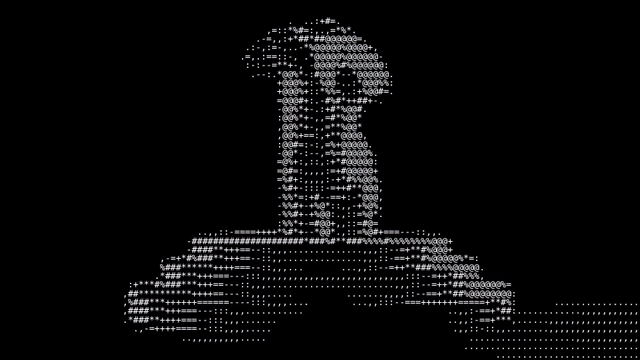
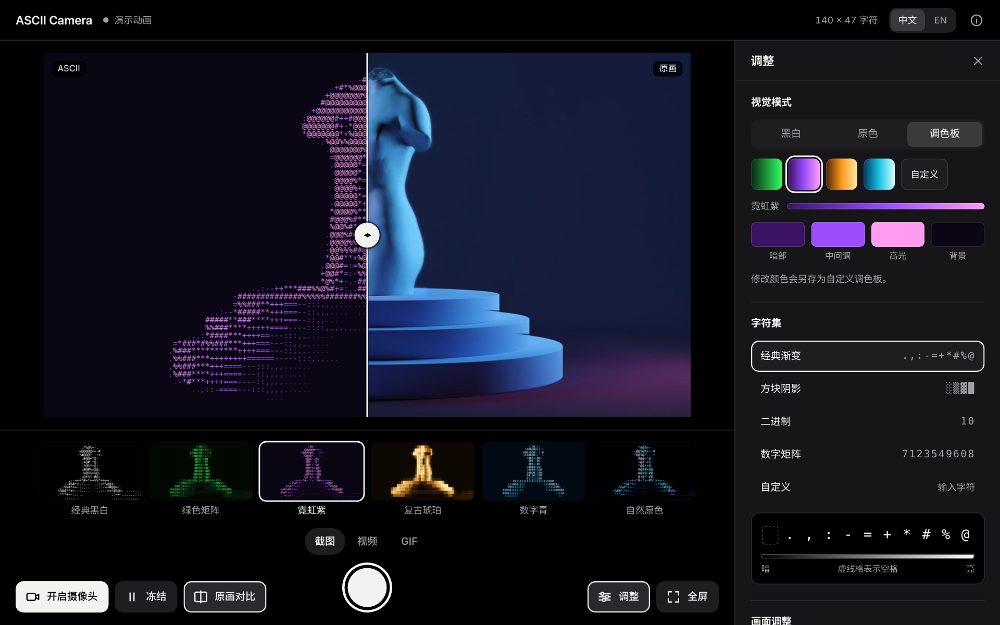

# ASCII Camera

[English](README.md) · **简体中文**

**v1.0.0 · 正式 Git 封板阶段（Phase 06.3.2）。** 功能已冻结。项目负责人已确认演示素材的使用、公开再分发及相关展示授权；Word / PDF 项目介绍已同步为 1.0.0，PDF 为 11 页。尚未公开部署或创建正式版本 Tag。

在浏览器里把摄像头画面实时转换成字符画。选择一种风格，与原画对比，再把作品保存为 PNG、MP4、WebM 或 GIF。所有处理都在本地完成，不会上传任何内容。


页面一打开就会循环播放一段雕塑旋转的演示视频，不授权摄像头也能体验全部功能。开启摄像头后，同一套效果会作用于你自己的画面。



<sub>由 ASCII Camera 自带的 MP4 导出录制，再转换为 GIF。</sub>

目前还没有公开部署的网址，可以按[快速开始](#快速开始)在本地运行。

## 功能

- **实时预览**
  - 画面来自演示视频或摄像头，两者共用同一条处理管线。
  - 字符密度 60～180 列，亮度 -50～+50，对比度 50%～150%。
  - 自动色阶；镜像默认开启。
- **三种视觉模式**
  - 黑白。
  - 原色：每个字符取其所在区域的颜色。
  - 调色板：暗部 → 中间调 → 高光渐变，加独立背景色。内置四套调色板；自定义调色板不会改动内置默认值。
- **五种字符集**
  - 经典渐变 ` .,:-=+*#%@`、方块阴影 ` ░▒▓█`、二进制、数字矩阵。
  - 自定义字符梯度，输入时即时校验。
- **六种效果预设，带实时预览**
  - 每张卡片都以自己的风格播放演示视频。
  - 点击即可应用整套配置，之后仍可单独调整每一项。
- **原画对比、冻结、全屏**
  - 拖动分割线对比字符画与原画，支持鼠标、触屏和键盘。
  - 冻结会保留当前一帧，冻结期间仍可继续调整参数。
  - iPhone 上的全屏是页面内的沉浸式预览。
- **采集**
  - PNG：按画布实际像素输出。
  - 视频：30 FPS、无音频，最大 1920 × 1080。默认 MP4 / H.264，可选 WebM / VP9。
  - GIF：10 FPS，最长 10 秒，最宽 640 px。
- **界面**
  - 简体中文 / English，切换时不刷新页面。
  - 桌面、手机竖屏 / 平板、手机横屏各有独立布局。




## 快速开始

环境要求：

- Node.js 22.22.1（见 `.nvmrc`；`package.json` 要求 `>=22.12.0`），npm 10+。
- 较新的桌面或手机浏览器。摄像头只能在安全上下文中使用（`http://localhost` 或 `https://`）；演示模式不受此限制。

```bash
npm install
npm run dev        # http://localhost:5173
```

| 命令 | 作用 |
| --- | --- |
| `npm run dev` | 开发服务器 |
| `npm run dev:lan` | 在局域网开放开发服务器（HTTP，手机上不能使用摄像头） |
| `npm run dev:https` | 局域网 HTTPS，用于手机实机测试摄像头；需要本地证书（见下文） |
| `npm run typecheck` | TypeScript 类型检查 |
| `npm run lint` | Oxlint 代码检查 |
| `npm test` | 单元测试（Vitest） |
| `npm run build` | 类型检查并构建到 `dist/` |
| `npm run preview` | 在本地预览生产构建 |

构建产物是纯静态网站，`dist/` 可以放在任何静态托管服务上。

## 使用方法

1. 打开页面，演示视频会以字符画形式开始播放。
2. 点击一张预设卡片。打开 **调整**，可以修改视觉模式、调色板、字符集、密度、亮度和对比度；配置与任何预设都不一致时，预设区显示「已手动调整」。
3. 点击 **开启摄像头** 并允许访问，画面切换为你的摄像头，效果保持不变。点击 **停止摄像头** 回到演示视频。
4. 在快门上方选择 **截图**、**视频** 或 **GIF**，再按快门。视频格式（MP4 或 WebM）在 **调整 → 导出** 中选择。
5. 有多个摄像头时，摄像头运行期间可以在 **调整 → 摄像头** 中切换；录制期间不能切换。

### 效果预设

| 预设 | 视觉模式 | 调色板 | 字符集 | 密度 | 亮度 | 对比度 |
| --- | --- | --- | --- | --- | --- | --- |
| 经典黑白（初始配置） | 黑白 | — | 经典渐变 | 120 | 0 | 110% |
| 绿色矩阵 | 调色板 | 绿色矩阵 | 数字矩阵 | 140 | +5 | 120% |
| 霓虹紫 | 调色板 | 霓虹紫 | 经典渐变 | 140 | 0 | 115% |
| 复古琥珀 | 调色板 | 复古琥珀 | 方块阴影 | 130 | +5 | 110% |
| 数字青 | 调色板 | 数字青 | 二进制 | 150 | 0 | 120% |
| 自然原色 | 原色 | — | 经典渐变 | 120 | 0 | 100% |

预设不会改变摄像头设备、镜像、原画对比、冻结、全屏，也不会中断正在进行的录制。

### 字符集

所有字符梯度都按「从暗到亮」排列：暗部用稀疏字符，亮部用笔画密集的字符。

- **二进制与数字矩阵**
  - 数字按当前字体中实际的笔画面积排序。
  - 最前面加一个空格作为最暗的一级。
  - 想要「满屏 0 和 1」，可以在自定义字符梯度中输入 `01`。
- **自定义字符梯度**
  - 最多 64 个字符，至少 2 个有效字符。
  - 以下字符会被过滤并给出提示：控制字符、空格以外的空白字符、重复字符、组合字符与表情，以及在等宽字体中不占一个字符格的字形（例如中日韩文字）。
  - 输入无效时继续使用上一次的有效梯度。
- **方块阴影**使用 Unicode 块元素字符，严格来说不属于 ASCII；能否对齐取决于系统的等宽字体。

## 实现方式


技术栈为 Vite、React、TypeScript 和 Canvas 2D。运行时依赖只有 React 和 [gifenc](https://github.com/mattdesl/gifenc)。没有后端、账号或统计。

**统一画面来源，唯一渲染循环**

- 摄像头（隐藏的 `<video>`）和演示视频都实现同一个很小的 `FrameSource` 接口（图像、宽、高、是否就绪）。
- 渲染器只依赖这个接口，所以对比、冻结、截图和录制在两种来源下的行为完全一致。
- 任何时刻只运行一个主渲染循环：
  - 摄像头使用 `requestVideoFrameCallback`（不支持时退回 `requestAnimationFrame`）。
  - 演示视频使用限制在 30 FPS 的 `requestAnimationFrame`。

**摄像头生命周期**

- 每次开启、停止、出错、组件卸载或离开页面，会话编号都会加一。异步流程在每个 `await` 之后检查编号；例如用户在权限弹窗期间点了停止，随后拿到的视频流会被立即释放。
- 切换设备时先打开新摄像头、再关闭旧的，切换失败时原摄像头不受影响。如果驱动不允许同时打开两个摄像头，会先释放旧设备再重试，仍然失败时尝试恢复原设备。
- 摄像头被拔出或被其他程序占用时，画面回到演示视频并给出提示。

**一帧的渲染过程**

1. 把画面绘制到 `列 × 行` 像素的小画布上，镜像在这一步完成，所以字符本身不会被翻转。
2. 行数根据当前字体实际测得的字宽计算，保证画面比例不变。
3. 计算每个格子的 BT.601 明度，用直方图得到自动黑白点（2% / 98% 分位，帧间平滑）。
4. 对比度和亮度在色阶之后施加，所以自动色阶不会抵消手动调整。结果是每帧一张 256 级查找表，同时决定字符和色调。
5. 黑白模式：每行调用一次 `fillText`。
6. 原色和调色板模式：先画白色文字层，再用「每个字符格一个像素」的颜色图以 `source-in` 合成着色。调色板颜色来自在 OKLCH 中插值的 256 级查找表，只在调色板变化时重建。

**预设预览**

- 六张卡片使用同一个演示 `<video>`：只解码一次，时间基准相同。
- 每次刷新只把当前帧缩小复制一次到共享的 240 × 135 画布。六个小尺寸渲染器各自按预设参数渲染；列数为预设的 40%，以便在卡片尺寸下看清字符差异。
- 预览约 10 FPS。页面开始掉帧时自动降低帧率（最低 4 FPS）；滚出视口的卡片不渲染，页面在后台时暂停。

**React 的职责**

- 只管理界面和低频状态。参数直接写入渲染器，下一帧生效，不重新启动摄像头，也不新建渲染循环。
- 语言是一个 context 值，切换语言只更新文字，不会重新挂载任何组件。

**视频录制**

- 开始录制时，按当时的画布尺寸创建一块固定尺寸的录制画布（偶数宽高，最大 1920 × 1080）。之后按 30 FPS 的独立时间轴，把可见画布复制过去，并通过 `captureStream(0)` + `requestFrame()` 逐帧提交。
- 由于录制画布尺寸固定，录制中途进入全屏、调整窗口或在摄像头与演示视频之间切换，都不会改变视频分辨率。
- `MediaRecorder` 编码为 MP4 / H.264 或 WebM / VP9（VP8 作为退路），码率按分辨率估算为 2.5～12 Mbps。

**补全视频文件**

- Chrome 的 MediaRecorder 写出的是「直播式」文件：
  - WebM：Segment 和 Cluster 长度未知，没有时长和索引。
  - MP4：分片结构，时长为 0。
- 项目只改写容器，不重新编码：
  - WebM：补上已知长度的 Cluster、时长和 Cues。
  - MP4：改写为 `ftyp | moov | mdat`，带完整样本表和关键帧索引。
- 改写失败时仍交付原始录像，并提示部分播放器可能无法正确显示时长或拖动进度条。

**GIF**

- 以 10 FPS 采样，缩放到最宽 640 px。
- 像素以 Transferable 方式交给 Web Worker 逐帧编码（每帧 256 色）。主线程最多只暂存一帧未压缩画面。


## 项目结构

```
src/
  App.tsx                     页面布局：取景器、预设卡片、采集区、调整面板
  main.tsx、index.css
  ascii/                      渲染器、字符集、调色板、效果预设、字形测量、参数
  camera/                     getUserMedia、错误归类、渲染循环
  media/frameSource.ts        摄像头与演示视频的 FrameSource
  demo/                       DemoSource、statue-demo.mp4、statue-poster.jpg
  presets/                    PresetPreviewManager（预设动态预览）
  export/                     录制、MP4 / WebM 容器改写、GIF Worker、下载
  hooks/                      useAsciiCamera、useExports、useFullscreen、useCameraDevices、useLayout
  components/                 界面组件
  i18n/                       zh-CN.ts、en.ts 与语言状态
tests/                        Vitest 单元测试与录制样本
tools/demo-video/             由原片制作演示视频的脚本
docs/                         需求基线、演示视频说明、手机测试指南、展示资源
```

## 浏览器与设备

应用会检查每一项所需的浏览器能力，缺失时降级，而不是直接失效：

| 能力 | 用于 | 缺失时 |
| --- | --- | --- |
| 安全上下文中的 `getUserMedia` | 摄像头 | 继续播放演示视频，并说明原因 |
| `requestVideoFrameCallback` | 摄像头帧时序 | 改用 `requestAnimationFrame` |
| `MediaRecorder` + `canvas.captureStream` | 视频录制 | 视频录制不可用 |
| MP4 录制支持 | MP4 | 改用 WebM（例如 Firefox） |
| Web Worker | GIF | GIF 不可用 |
| 元素全屏 | 全屏 | 页面内沉浸式预览（例如 iPhone） |
| `IntersectionObserver` | 暂停视口外的预设卡片 | 所有卡片持续渲染 |

**测试覆盖情况**

- 前序浏览器检查在 Chrome 无头模式中运行，使用演示视频和 Chrome 的虚拟摄像头；单元测试在 Node.js 的 Vitest 中运行。
- Phase 06.3 在 Windows 的 Edge 158 无头模式下独立通过了生产构建冒烟检查，覆盖实际下载、虚拟摄像头释放及录制中调整；Firefox、Safari 尚未验证。
- 真实手机（iPhone Safari、Android Chrome）还需要最后一轮人工验收。

### 手机实机测试

手机浏览器只允许在 HTTPS 或 `localhost` 下使用摄像头。`npm run dev:https` 会在局域网内以 HTTPS 提供页面，证书由你用 [mkcert](https://github.com/FiloSottile/mkcert) 在本机生成，放在 `.cert/`（已被 Git 忽略）。完整步骤（包括在 iPhone 和安卓上信任本地 CA，以及安卓的 USB 端口转发方案）见 [docs/mobile-testing.zh-CN.md](docs/mobile-testing.zh-CN.md)。

## 测试

```bash
npm test
```

单元测试覆盖 MP4 与 WebM 容器改写，样本是 Chrome MediaRecorder 录制的短视频（`tests/fixtures/`）。测试用独立的解析器检查以下几点：

- 输出结构完整。
- 样本和数据块字节不变。
- 时长与拖动索引正确。
- 截断或损坏的输入会退回原文件，且不会抛出异常。

`npm run typecheck` 和 `npm run lint` 对其余代码做静态检查。此前各开发阶段的浏览器回归与性能检查不在仓库中。

## 隐私

- 演示视频随网页一起提供，不加载任何远程素材。
- 摄像头画面、截图、视频和 GIF 只在你的浏览器中处理和生成，不会上传。项目没有后端、账号、统计或云存储。
- 点击 **开启摄像头** 后才申请权限，而且只申请摄像头，从不申请麦克风。停止、切换设备或离开页面时会立即释放摄像头。
- 文件通过本地 Blob URL 下载：
  - 截图的 URL 在下载开始几秒后释放。
  - 视频 / GIF 的下载链接保留到下一次导出、手动关闭或离开页面为止。
- 本地存储只保存四项界面偏好：语言、面板开合、采集格式、视频格式。

## 已知限制

- **视频分辨率**：在开始录制时确定，最大 1920 × 1080。录制中画布尺寸变化时，画面等比缩放并留黑边。
- **长时间 WebM 录制**：WebM 的容器改写需要把整段录像读入内存（峰值约为文件大小的 2～3 倍），且视频录制没有时长上限。长时间录制 WebM（尤其在手机上）可能因内存不足而退回原始文件。MP4 改写按片读取，不受影响，长时间录制建议使用 MP4。
- **WebM 兼容性**：iPhone 相册等处无法播放 WebM。
- **GIF**：每帧最多 256 色，渐变会出现色带；文件较大（10 秒 640 × 360 约几 MB）。
- **后台标签页**：浏览器会降低后台标签页的刷新频率，录制会卡住，演示视频和预设预览也会暂停。请在前台录制。
- **设备名称**：浏览器只有在获得摄像头权限后才提供设备名称。

## 文档

- [项目介绍](docs/intro/ascii-camera-introduction.zh-CN.pdf)（[Word 版](docs/intro/ascii-camera-introduction.zh-CN.docx)）：产品、架构、渲染、录制与主要工程问题，附实际界面截图。
- [项目需求基线](docs/PROJECT-BRIEF.zh-CN.md)：各开发阶段对照的需求范围。
- [演示视频说明](docs/demo-video.zh-CN.md)：素材的调色、编码过程与授权说明。
- [手机实机测试：局域网 HTTPS](docs/mobile-testing.zh-CN.md)。

## 许可证

代码以 [MIT 许可证](LICENSE)发布。

演示视频与海报帧（`src/demo/statue-demo.mp4`、`src/demo/statue-poster.jpg`）是第三方素材，**不在** MIT 许可范围内：

- 项目负责人于 2026-11-24 确认本项目非商用使用、公开再分发、相关展示及导出所需授权没有问题，见 [docs/demo-video.zh-CN.md](docs/demo-video.zh-CN.md)。这是负责人确认记录，不是底层授权条款原文，也不授予其他用途的通用许可。
- `docs/assets/` 中的截图、GIF 及 `docs/intro/` 的 Word / PDF 项目介绍图片包含该素材，属于上述确认范围，仍不纳入项目 MIT 许可。
- 如果将本项目用于其他用途，请替换演示视频。

| 依赖 | 许可证 | 说明 |
| --- | --- | --- |
| [React](https://react.dev) | MIT | 界面 |
| [gifenc](https://github.com/mattdesl/gifenc) 1.0.3 | MIT；PNN 派生量化器为 MPL-2.0 | GIF 编码；随 Worker 提供准确的对应源码与通知 |
| Vite、TypeScript、Oxlint、Vitest | MIT / Apache-2.0 | 仅用于开发与构建，不进入发布产物 |

运行时版权通知见 [third-party-licenses.txt](public/third-party-licenses.txt)，[对应 gifenc 源码和许可文本](public/vendor/gifenc-1.0.3/NOTICE.txt)随构建提供。已找到 gifenc 引用之前即使用 MPL-2.0 的 PnnQuant.js 历史源码，详见[授权链核查记录](docs/licenses/gifenc-1.0.3-provenance.zh-CN.md)。ASCII Camera 自有独立源码继续使用 MIT。

## 作者

**[nine19een](https://nine19een.com)**

源代码：[github.com/nine19een/ascii-camera](https://github.com/nine19een/ascii-camera)
